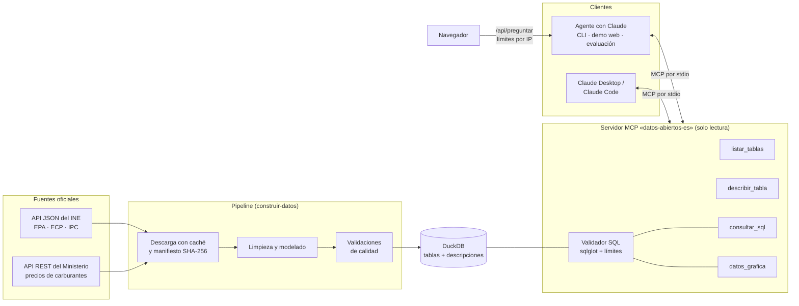

# Habla con los datos públicos de España

**Un agente de IA con un servidor MCP propio que responde preguntas en lenguaje natural sobre datos
oficiales de España (paro, población, inflación y precios de carburantes), enseñando la cifra, la
consulta SQL que la produjo y la fuente.**

> *English summary below.*

**Resultados de la evaluación (40 preguntas × 2 repeticiones, Claude Haiku 5.5):** el **100 %** de
las respuestas son correctas según un juez independiente, y en el **88 %** de los casos la propia consulta
SQL devuelve exactamente la cifra de referencia. Cuesta **~0,001 $ por pregunta** y tarda **~5 s**
(mediana). [Detalles](#resultados).

---

## El problema

Los datos públicos españoles son abiertos, pero no son fáciles de consultar: hay que saber en qué
tabla del INE está cada cosa, descargarla, entender sus códigos y cruzarla con otras. Preguntar a un
chatbot genérico tampoco sirve: responde de memoria, con datos antiguos o inventados, y sin decir de
dónde salen.

Este proyecto conecta un modelo de lenguaje con **datos reales y actualizados** a través de un
**servidor MCP de solo lectura**, de modo que:

- cada número de la respuesta sale de una consulta SQL ejecutada sobre los datos oficiales;
- el usuario ve esa consulta, los datos devueltos y la fuente con su licencia;
- el modelo **no puede** modificar los datos, leer ficheros del servidor ni salirse de las tablas publicadas;
- la calidad se **mide** con un conjunto de preguntas de respuesta conocida, no se supone.

## Qué se puede preguntar

| Tabla | Contenido | Desde | Fuente |
|---|---|---|---|
| `paro_epa` | Tasa de paro trimestral por comunidad, sexo y grupo de edad | 2002 | INE · EPA (tabla 65334) |
| `poblacion` | Población residente a 1 de enero por comunidad, sexo y grupo de edad | 2002 | INE · Estadística Continua de Población (tabla 56940) |
| `ipc` | Inflación mensual (variación mensual, anual y acumulada) por comunidad | 2002 | INE · IPC (tabla 76140) |
| `gasolineras` | Las ~11.500 gasolineras de España con sus precios del día | foto diaria | Ministerio para la Transición Ecológica |
| `carburantes_semanal` | Precio medio, mediano, mínimo y máximo por comunidad y carburante, cada lunes | últimas 26 semanas | Ministerio para la Transición Ecológica |
| `comunidades`, `fuentes` | Códigos y nombres de comunidades; origen y licencia de cada tabla | | |

Ejemplos: *«¿Qué comunidades tienen más paro?»*, *«¿Cómo ha evolucionado la inflación desde 2020?»*,
*«¿En qué comunidad es más barata la gasolina esta semana?»*, *«¿Cuántas gasolineras hay por cada
100.000 habitantes?»* (cruza dos fuentes).

## Arquitectura



1. **Pipeline** (`src/datos_abiertos_mcp/pipeline/`): descarga las tablas de las APIs oficiales,
   guarda cada fichero bruto con su URL, fecha y hash (`data/raw/*/manifiesto.json`), normaliza
   códigos y nombres, agrega edades simples en grupos y carga todo en DuckDB con un `COMMENT` en cada
   tabla y columna. El histórico de carburantes (unas 300.000 filas gasolinera-día) se agrega
   directamente con `read_json` de DuckDB. Cinco **validaciones de calidad** detienen el proceso si
   algo no cuadra (códigos desconocidos, grupos de edad que no suman el total, comunidades que no
   suman España, tasas o precios fuera de rango). Todo se reconstruye en ~11 s con la caché.
2. **Servidor MCP** (`servidor_mcp.py`, SDK oficial de MCP para Python): cuatro herramientas de solo
   lectura que explican al modelo qué significa cada columna, qué valores admite y cuál es su rango.
3. **Agente** (`agente.py`): Claude (Haiku 5.5 por defecto, configurable con `CLAUDE_MODELO`) recibe la pregunta y las herramientas del servidor MCP,
   explora el esquema, escribe el SQL, lo corrige si falla y responde. El bucle registra el SQL
   ejecutado, las fuentes, los datos de la gráfica, los tokens y el modelo que respondió.
4. **Demo web** (`web/`): FastAPI + una página HTML/JS sin dependencias externas.
5. **Evaluación** (`evaluacion.py`, `eval/preguntas.jsonl`).

### Por qué Python

Es el lenguaje de referencia en ingeniería de datos y ML, DuckDB tiene su cliente más completo en
Python, y el SDK oficial de MCP para Python permite definir herramientas tipadas con un decorador.
Un único lenguaje cubre el pipeline, el servidor, el agente, la evaluación y la API web.

## Seguridad

El SQL lo escribe un modelo de lenguaje, así que se trata como **entrada no confiable**. Hay tres
capas independientes:

| Capa | Qué hace |
|---|---|
| **Base de datos** | DuckDB se abre en modo **solo lectura**, con `enable_external_access = false` (no puede leer ni escribir ficheros ni URLs), sin instalar ni cargar extensiones, con la configuración bloqueada (`lock_configuration`), 512 MB de memoria y 2 hilos. |
| **Validación del SQL** | Con `sqlglot`: una sola sentencia; tiene que ser una consulta (`SELECT`/`WITH`/`UNION`); solo puede leer las tablas publicadas (ni `information_schema`, ni otras bases de datos, ni funciones de tabla como `read_csv` o `glob`); se rechazan funciones como `getenv`, `current_setting`, `read_*`… |
| **Ejecución** | Límite de **10 s** por consulta (se interrumpe) y de **500 filas** devueltas. |
| **Demo web** | La clave de Claude solo existe en el servidor; límites por IP (5 preguntas/hora, 20/día) y tope global de 50 preguntas/día; preguntas de 3 a 300 caracteres; Content-Security-Policy estricta; el texto del modelo se inserta siempre como texto, nunca como HTML. |
| **Secretos** | El subproceso MCP no recibe la clave de la API (no la necesita). `.env` está en `.gitignore`. |

Los tests (`tests/test_seguridad.py`) prueban más de 30 intentos de abuso: `DROP`, `COPY … TO`,
`ATTACH`, `INSTALL`, `PRAGMA`, `SET`, lectura de ficheros, `getenv('ANTHROPIC_API_KEY')`,
sentencias encadenadas, CTE con `DELETE`, consultas lentas… y comprueban que, aunque se saltara el
validador, la propia conexión rechaza escribir o leer ficheros.

## Cómo ejecutarlo

Requisitos: Python 3.12 y [uv](https://docs.astral.sh/uv/).

```bash
git clone https://github.com/Carlosvd7/datos-abiertos-mcp.git
cd datos-abiertos-mcp
uv sync

# 1. Descargar y construir la base de datos (unos minutos la primera vez; luego ~11 s)
uv run construir-datos

# 2. Clave de la API de Claude (solo para el agente, la evaluación y la demo)
cp .env.example .env        # y escribe tu ANTHROPIC_API_KEY dentro

# 3. Preguntar desde la terminal
uv run preguntar "¿Qué comunidad tiene más paro?"

# 4. Demo web en http://127.0.0.1:8000
uv run demo

# Tests (no necesitan clave ni red)
uv run pytest
```

### Usar el servidor MCP desde Claude Desktop o Claude Code

El servidor no necesita clave de API: es Claude Desktop o Claude Code quien pone el modelo.

**Claude Code:**

```bash
claude mcp add datos-abiertos-es -- uv --directory /ruta/a/datos-abiertos-mcp run servidor-mcp
```

**Claude Desktop** (`claude_desktop_config.json`):

```json
{
  "mcpServers": {
    "datos-abiertos-es": {
      "command": "uv",
      "args": ["--directory", "/ruta/a/datos-abiertos-mcp", "run", "servidor-mcp"]
    }
  }
}
```

También se puede servir por HTTP (Streamable HTTP): `uv run servidor-mcp --http --port 8001`
→ `http://127.0.0.1:8001/mcp`.

## Evaluación

`eval/preguntas.jsonl` contiene **40 preguntas** en español:

- **37 con respuesta conocida**, repartidas entre paro (11), población (8), IPC (7), carburantes (8) y
  preguntas que cruzan tablas (3). Cada una tiene un **SQL de referencia escrito y revisado a mano**.
  La respuesta correcta se calcula ejecutando ese SQL **sobre la misma base de datos en el momento de
  evaluar**, de modo que la evaluación no caduca cuando el INE publica datos nuevos.
- **3 sin respuesta en los datos** (paro de 1995, alquiler en Madrid, paro de un municipio): el agente
  debe decir que no tiene ese dato en vez de inventarlo.

Métricas, por separado:

| Métrica | Cómo se mide |
|---|---|
| **Precisión por ejecución** | El último resultado SQL del agente contiene la respuesta de referencia: valor en la primera fila, o las mismas filas (con o sin orden, según la pregunta). Números con tolerancia de redondeo; nombres de comunidad equivalentes («Madrid, Comunidad de» = «Comunidad de Madrid»). |
| **Respuesta correcta (juez)** | Claude Sonnet 5.5 lee la respuesta en texto y la compara con el resultado de referencia, con un criterio explícito y salida estructurada. Mide lo que ve el usuario. |
| **Preguntas sin datos bien gestionadas** | El juez comprueba que el agente admite que no tiene el dato y no inventa cifras. |
| **Cita la fuente** | La respuesta menciona el organismo (INE / Ministerio). |

Además se registran el coste (con los tokens reales de la API), el tiempo, las llamadas MCP, los
errores de SQL corregidos por el agente, y la trayectoria completa de cada pregunta. Los fallos de
infraestructura (API caída, timeouts) se guardan aparte y no cuentan como fallos del modelo. El
evaluador tiene sus propios tests: el SQL de referencia aprueba contra sí mismo, un resultado vacío
suspende y la respuesta de otra pregunta casi nunca aprueba.

```bash
uv run evaluar --juez               # ~40 preguntas
uv run evaluar --solo paro-03 ipc-02
```

### Resultados

Ejecutada el 26/11/2026 sobre los datos de esa fecha (paro hasta 3T 2026, población a 1 de enero de
2026, IPC hasta octubre de 2026, carburantes hasta el 23/11/2026). Agente: **Claude Haiku 5.5**
(esfuerzo `medium`). Juez: **Claude Sonnet 5.5**. 40 preguntas × 2 repeticiones = 80 intentos;
0 errores de infraestructura. Intervalos de confianza de Wilson al 95 %.

| Métrica | Prompt v1 | **Prompt v2** |
|---|---|---|
| Respuesta correcta (juez), 74 intentos | 97,3 % [90,7 – 99,3] | **100 %** [95,1 – 100] |
| Precisión por ejecución (el SQL devuelve la respuesta), 74 intentos | 55,4 % [44,1 – 66,2] | **87,8 %** [78,5 – 93,5] |
| Preguntas sin datos bien gestionadas, 6 intentos | 100 % | **100 %** |
| Cita la fuente | 100 % | **100 %** |
| Coste medio del agente por pregunta | 0,0010 $ | **0,0010 $** |
| Mediana de tiempo por pregunta | 4,8 s | **4,7 s** |
| Llamadas MCP por pregunta (media) | 3,8 | **3,7** |

Precisión por ejecución en v2, por tema: carburantes 16/16, combinadas 6/6, paro 20/22,
población 13/16, IPC 10/14. Coste total de cada pasada: ~0,08 $ el agente + ~0,23 $ el juez.

**Qué cambió de v1 a v2.** En v1 el agente acertaba casi siempre, pero a menudo traía una lista de
datos (por ejemplo los 12 meses de 2020) y contaba o restaba «de cabeza»: la cifra final no salía de
ninguna consulta que el usuario pudiera revisar. En v2 se añadió una única instrucción general al
prompt del agente (*«haz en SQL todos los cálculos que pida la pregunta; la consulta debe devolver
directamente la cifra»*). No se tocó ninguna pregunta ni el evaluador entre las dos pasadas. En la
misma revisión se corrigió un fallo del evaluador (solo miraba la última consulta del agente, no la
que contenía la respuesta); la columna v1 está recalculada con el evaluador corregido sobre las
respuestas guardadas.

**Revisión manual de los fallos.**

- Los 9 intentos que no pasan por ejecución en v2 tienen respuesta correcta: el SQL trae algo más que
  la respuesta (un top 5 en vez del primero, o la serie completa con el dato en otra fila). La
  métrica es estricta a propósito.
- En v1, de los 2 fallos del juez, uno era real (una conclusión falsa sobre una serie) y otro era un
  **error del propio juez** (la cifra era correcta y su explicación lo reconocía). No se ajustó el
  juez para corregirlo.
- El juez valora la cifra que responde a la pregunta: en un caso (ipc-06) la respuesta acertaba la
  cifra pero se contradecía en un dato secundario de contexto, y el juez no lo penalizó.

Los resultados completos, con la trayectoria de cada pregunta (llamadas MCP, SQL, resultados,
veredicto del juez), están en `eval/resultados/`.

## Limitaciones

- **Datos congelados en cada despliegue**: la demo trae los datos del día en que se construyó la
  imagen; para actualizarlos hay que reconstruirla (el pipeline es idempotente).
- **Nivel territorial**: paro, población e IPC están por comunidad autónoma, no por provincia ni
  municipio. Los precios de carburantes sí están por gasolinera.
- **Población 2002–2012**: en las series retroestimadas del INE, el total publicado difiere de la
  suma por edades en hasta 9 personas; se conservan los totales oficiales.
- **Coordenadas**: algunas gasolineras tienen coordenadas erróneas en el origen; no se corrigen.
- **Licencia de carburantes**: la página del conjunto de datos del Ministerio no indica una licencia
  Creative Commons explícita; se reutiliza como información del sector público (Ley 37/2007) citando
  la fuente y la fecha.
- **La evaluación es pequeña** (40 preguntas): los intervalos de confianza son amplios y una sola
  pregunta mueve ~3 puntos. Mide bien regresiones grandes, no diferencias finas entre modelos. El
  juez es otro modelo de lenguaje y puede equivocarse (se encontró un error suyo al revisar a mano).
- **El límite de uso de la demo vive en memoria**: vale para una instancia; con varias haría falta un
  almacén compartido (p. ej. Redis).
- Un modelo de lenguaje puede equivocarse al interpretar una pregunta ambigua: por eso la demo
  enseña siempre el SQL y los datos.

## Fuentes y licencias

- **INE** — Encuesta de Población Activa, Estadística Continua de Población e Índice de Precios de
  Consumo. Licencia [CC BY 4.0](https://www.ine.es/dyngs/AYU/index.htm?cid=125).
  Cita: *Elaboración propia con datos extraídos del sitio web del INE: www.ine.es*.
- **Ministerio para la Transición Ecológica y el Reto Demográfico** — Precios de carburantes en las
  estaciones de servicio ([Geoportal de gasolineras](https://geoportalgasolineras.es/)), API REST
  `sedeaplicaciones.minetur.gob.es/ServiciosRESTCarburantes`. Reutilización conforme a la Ley 37/2007
  citando la fuente.

Este proyecto no está afiliado ni respaldado por el INE ni por el Ministerio.

## Estructura

```
src/datos_abiertos_mcp/
├── pipeline/        descarga.py · ine.py · carburantes.py · modelos.py · esquema.py · construir.py
├── almacen.py       acceso seguro a DuckDB (validador SQL, límites, metadatos)
├── servidor_mcp.py  servidor MCP (stdio o HTTP)
├── agente.py        agente con Claude sobre las herramientas MCP (CLI: preguntar)
├── evaluacion.py    evaluación text-to-SQL (CLI: evaluar)
└── web/             demo FastAPI + página estática
eval/preguntas.jsonl preguntas con SQL de referencia
tests/               pipeline, seguridad, servidor MCP, agente, evaluación y web
Dockerfile           imagen de la demo (construye los datos al crearse)
```

---

## English summary

**Talk to Spain's public data** — an AI agent with its own **MCP server** that answers natural-language
questions about official Spanish open data (unemployment, population, inflation and fuel prices),
showing the figure, the SQL that produced it and the source.

- **Data pipeline**: reproducible ingestion from the INE (National Statistics Institute) JSON API and the
  Ministry for the Ecological Transition REST API into **DuckDB**, with cached raw files + SHA-256
  manifest, column-level descriptions and data-quality checks that stop the build.
- **MCP server** (official Python SDK): `listar_tablas`, `describir_tabla`, `consultar_sql`,
  `datos_grafica`. Defence in depth: read-only DuckDB with external access and extensions disabled,
  `sqlglot` validation (single read-only query, allow-listed tables, no file/env functions), 10 s
  timeout and 500-row cap. 30+ abuse tests.
- **Agent**: Claude (Haiku 5.5 by default, configurable) explores the schema through MCP, writes and self-corrects SQL, and answers
  with the query, data and citation.
- **Evaluation**: 40 Spanish questions (37 with hand-written reference SQL, 3 unanswerable), execution
  accuracy computed against the live database, plus an LLM judge (Claude Sonnet 5.5) for the final
  answer, cost and latency.
- **Results** (40 questions × 2 runs, Claude Haiku 5.5): **100 %** of final answers judged correct,
  **88 %** execution accuracy (the SQL itself returns the reference answer; 55 % before a one-line
  prompt change asking the agent to do all arithmetic in SQL), ~$0.001 and ~5 s per question.
- **Web demo**: FastAPI + dependency-free page; API key server-side only, per-IP and global rate limits,
  strict CSP, accessible SVG charts. Dockerfile included.

Run it: `uv sync && uv run construir-datos && uv run demo`. Use the MCP server from Claude Code with
`claude mcp add datos-abiertos-es -- uv --directory /path/to/repo run servidor-mcp`.
